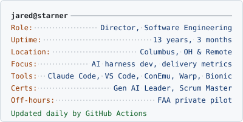

<!-- card:start -->
<picture>
  <source media="(prefers-color-scheme: dark)" srcset="assets/card-dark.svg">
  
</picture>
<!-- card:end -->

Hey, welcome to my GitHub Profile. Most of my work lives in private repos; experiments ship daily at [thesandbox.page](https://thesandbox.page).

**Latest experiments**
<!-- experiments:start -->
- [Seismograph](https://thesandbox.page/seismograph/ "A drum recorder wired to a real seismometer: pick a vault anywhere from Albuquerque to Antarctica, watch the pen write the last day of ground motion, see where each earthquake's waves should land, and hear the whole day sped up six thousand times."): a drum recorder wired to a real…
- [Marbling](https://thesandbox.page/marbling/ "A marbler's trough of size: float drops of pigment, draw a stylus, rake, or comb through them, and lay a sheet of paper down to pull a print of every vein."): a marbler's trough of size
- [Music box](https://thesandbox.page/music-box/ "A thirty-note paper-strip music box on a walnut table: punch holes in the strip, turn the crank, and every hole plucks a steel tooth that rings with its own inharmonic overtones."): a thirty-note paper-strip music box on…
<!-- experiments:end -->

**Generative AI Leader** 
Google Cloud &middot; Jun 2026 &middot; [Verify on Credly](https://www.credly.com/badges/04e8a3e0-7407-4dc6-ba24-8ac551aa67cf/public_url)

<picture>
  <source media="(prefers-color-scheme: dark)" srcset="assets/skills-dark.svg">
  
</picture>
