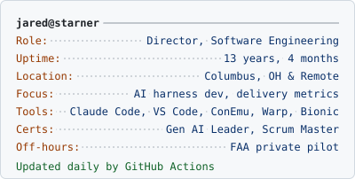

<!-- card:start -->
<picture>
  <source media="(prefers-color-scheme: dark)" srcset="assets/card-dark.svg">
  
</picture>
<!-- card:end -->

Hey, welcome to my GitHub Profile. Most of my work lives in private repos; experiments ship daily at [thesandbox.page](https://thesandbox.page).

**Latest experiments**
<!-- experiments:start -->
- [Ring the bell](https://thesandbox.page/ring-the-bell/ "A carnival pinball machine wired the way they were in the sixties: score reels that turn, chimes that ring for every ten, hundred, and thousand, a gallery of ducks to knock down, and a strength-test lane that rings the bell only for a clean, hard shot."): a carnival pinball machine wired…
- [Still scans](https://thesandbox.page/still-scans/ "A QR code you can paint into, put your photo in, or deface: draw on it and the code rearranges its own spare bits to keep every stroke and still scan, then scribble, spill, and tear it and watch the error correction hold until it can't."): a QR code you can paint into
- [Loom](https://thesandbox.page/loom/ "A four-shaft floor loom and the draft it weaves from: thread the heddles, tie up the treadles, and weave cloth pick by pick, then change only the colour order and watch the same twill turn into houndstooth."): a four-shaft floor loom and the draft it…
<!-- experiments:end -->

**Generative AI Leader** 
Google Cloud &middot; Jun 2026 &middot; [Verify on Credly](https://www.credly.com/badges/04e8a3e0-7407-4dc6-ba24-8ac551aa67cf/public_url)

<picture>
  <source media="(prefers-color-scheme: dark)" srcset="assets/skills-dark.svg">
  
</picture>
