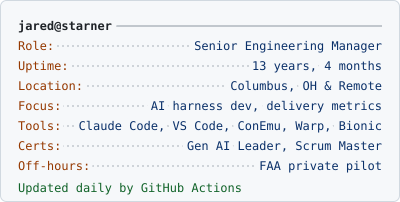

<!-- card:start -->
<picture>
  <source media="(prefers-color-scheme: dark)" srcset="assets/card-dark.svg">
  
</picture>
<!-- card:end -->

Hey, welcome to my GitHub Profile. Most of my work lives in private repos; experiments ship daily at [thesandbox.page](https://thesandbox.page).

**Latest experiments**
<!-- experiments:start -->
- [Ropesight](https://thesandbox.page/ropesight/ "A church tower's ringing chamber on practice night: take hold of a rope, ring rounds with the band, then follow Plain Bob and Grandsire as the order of the bells changes at every blow, with each bell swinging full circle and its clapper striking where the physics puts it, and your striking timed to the millisecond and lettered onto a peal board."): a church tower's ringing chamber on…
- [Lost property](https://thesandbox.page/lost-property/ "A railway lost-property ledger kept from 1924 to 1986, every line blank until you search for it with your browser's own Find: ask for an umbrella, a glove, a tortoise, or a book, and what the three clerks wrote about it inks itself in, until sixty years of strange articles and one long wait come together."): a railway lost-property ledger kept…
- [Breadboard](https://thesandbox.page/breadboard/ "A solderless breadboard, a 9 V battery, a drawer of parts, and a multimeter: plug in resistors, LEDs, a 555 timer, and a decade counter, wire them up, and the circuit is solved two thousand times a second, so lights blink, chase, fade, and burn out the way they would on a real bench."): a solderless breadboard
<!-- experiments:end -->

**Generative AI Leader** 
Google Cloud &middot; Jun 2026 &middot; [Verify on Credly](https://www.credly.com/badges/04e8a3e0-7407-4dc6-ba24-8ac551aa67cf/public_url)

<picture>
  <source media="(prefers-color-scheme: dark)" srcset="assets/skills-dark.svg">
  
</picture>
